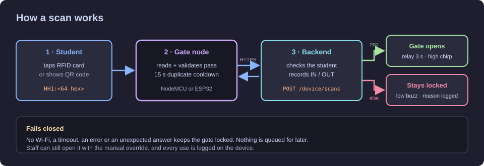
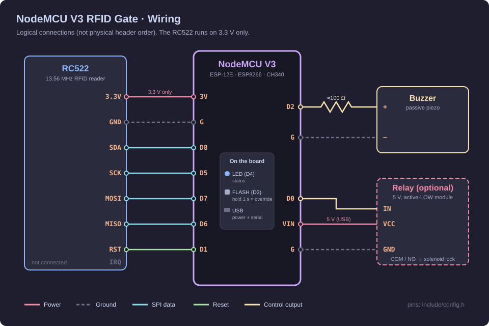
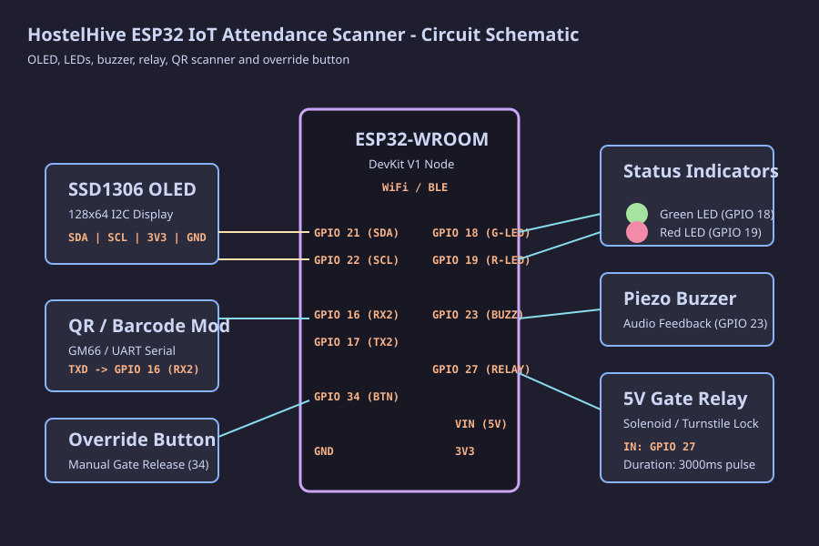

<p align="center">
  
</p>

<p align="center">
  <a href="https://github.com/Hostel-Hive/hostelhive-hardware/actions/workflows/firmware-ci.yml"></a>
  <a href="https://platformio.org/"></a>
  
  
  
  
  <a href="https://wokwi.com/"></a>
</p>

<p align="center">
  <a href="#hardware">Hardware</a> ·
  <a href="#wiring-guide">Wiring</a> ·
  <a href="#getting-started">Getting started</a> ·
  <a href="#writing-student-cards">Student cards</a> ·
  <a href="#troubleshooting">Troubleshooting</a>
</p>

---

The gate node is the device at a hostel entrance. A student taps an RFID card (or shows a QR code), the node checks the pass with the HostelHive backend over HTTPS, and opens the door lock only when the backend confirms it. Every entry and exit is recorded by the backend as an `IN` or `OUT` movement.

It is part of **HostelHive**, a hostel management system with a Go backend, a web dashboard and a mobile app.

## Features

- **Two builds from one codebase:** a low-cost NodeMCU (ESP8266) gate with an RC522 RFID reader, and an ESP32 gate with a QR scanner and OLED screen.
- **Fails closed:** no Wi-Fi, a timeout, a server error or an odd answer all keep the lock shut. Nothing is queued to be replayed later.
- **Secure by default:** HTTPS with a pinned root CA, a per-device credential, and passes and credentials are never printed in full to the log.
- **Duplicate-scan protection:** the same pass is ignored for 15 seconds.
- **Manual override:** staff hold a button for 1 second to open the gate, and every use is written to an on-device log.
- **Simulation:** the ESP32 build runs in [Wokwi](https://wokwi.com/) with no hardware at all.

## How it works

<p align="center">
  
</p>

An RFID card stores the same `HH1:` pass that is inside the student's QR code, so both kinds of gate send the backend exactly the same request. The card's UID is never used to identify anyone, because UIDs are easy to clone. Request and response details are in [docs/api_contract.md](docs/api_contract.md).

## Hardware

| | **NodeMCU RFID gate** | **ESP32 QR gate** |
|:---|:---|:---|
| Board | NodeMCU V3 (ESP-12E, CH340 USB) | ESP32-WROOM-32 DevKit V1 |
| Scanner | RC522 RFID reader + MIFARE Classic 1K cards | GM66 / Waveshare UART QR scanner |
| Feedback | Passive piezo buzzer, onboard LED, serial log | SSD1306 OLED, green + red LEDs, buzzer |
| Lock | 5 V active-LOW relay module (optional) | 5 V relay module |
| Override | Onboard FLASH button | Push button + 10 kΩ pull-up |
| Build | `nodemcu` | `esp32prod` (hardware), `esp32dev` (Wokwi) |

The full parts list is in [docs/bill_of_materials.md](docs/bill_of_materials.md).

## Wiring guide

### NodeMCU V3 + RC522

<p align="center">
  
</p>

| From | To NodeMCU | Notes |
|:---|:---|:---|
| RC522 **SDA** | `D8` | |
| RC522 **SCK** | `D5` | |
| RC522 **MOSI** | `D7` | Swapping MOSI and MISO is the most common mistake |
| RC522 **MISO** | `D6` | |
| RC522 **RST** | `D1` | |
| RC522 **3.3V** / **GND** | `3V` / `G` | ⚠️ Never 5 V or `VIN`: it damages the RC522 |
| RC522 **IRQ** | not connected | |
| Buzzer **+** | `D2` through ~100 Ω | Buzzer **−** to `G` |
| Relay **IN** / **VCC** / **GND** | `D0` / `VIN` / `G` | Use an active-LOW module, so the lock stays shut while the board boots |

The RC522 pins must be soldered. Header pins that only rest in the holes look connected but read as `Firmware Version: 0x0`. A larger "active" or magnetic buzzer needs an NPN transistor (BC547 or 2N2222 with a 1 kΩ base resistor), because an ESP8266 pin supplies only about 12 mA.

### ESP32 + QR scanner

<p align="center">
  
</p>

| Part | ESP32 pin |
|:---|:---|
| OLED SDA / SCL | `GPIO 21` / `GPIO 22` |
| Green / red LED | `GPIO 18` / `GPIO 19` |
| Buzzer | `GPIO 23` |
| Relay IN | `GPIO 27` |
| QR scanner RX / TX | `GPIO 16` / `GPIO 17` |
| Override button | `GPIO 34` with an external 10 kΩ pull-up to 3.3 V |

GPIO 34 has no internal pull-up. Without the resistor the pin floats and can open the gate. Both pin maps are also in [docs/pinout_mapping.md](docs/pinout_mapping.md) and `include/config.h`.

## Getting started

### 1. Install the tools

- [VS Code](https://code.visualstudio.com/) with the **PlatformIO IDE** extension. It installs the compilers and libraries the first time you build.
- **USB driver:** NodeMCU V3 boards use a CH340 chip. Many of them only work with the older **CH341SER 3.4** driver (see [Troubleshooting](#troubleshooting)).

This project builds with PlatformIO, not the Arduino IDE. You can still use the Arduino IDE's Serial Monitor to watch the gate.

### 2. Configure

```bash
cp include/secrets.example.h include/secrets.h
```

Then edit `include/secrets.h` (it is git-ignored, never commit it):

| Setting | Value |
|:---|:---|
| `WIFI_SSID`, `WIFI_PASSWORD` | A **2.4 GHz** network. ESP boards cannot see 5 GHz |
| `API_BASE_URL` | The backend's `https://` address, no path |
| `API_ROOT_CA` | PEM root CA of the backend's certificate |
| `DEVICE_CREDENTIAL` | The `hhd1.…` value shown once when an admin registers this scanner |

An admin must also set the scanner's direction (IN or OUT) in the admin panel. Until then every scan is refused with "GATE NOT CONFIGURED".

### 3. Build and upload

On Windows, from the project folder:

```bash
.\flash
```

| Command | What it does |
|:---|:---|
| `.\flash` | Build the NodeMCU firmware and upload it (the port is found automatically) |
| `.\flash monitor` | Same, then open the serial monitor |
| `.\monitor` | Open the serial monitor only (`.\monitor COM5` to choose the port) |
| `.\provision HH1:…` | Write a pass to a card (see below) |

Or use PlatformIO directly on any OS:

```bash
pio run -e nodemcu --target upload
pio device monitor --speed 115200
```

Use `-e esp32prod` for the ESP32 gate. Close any open serial monitor before uploading, or the upload fails with "Access is denied".

### 4. Check it started

A working NodeMCU gate prints:

```text
[RFID] RC522 ready (firmware 0x92) on SS=D8, RST=D1.
[NETWORK] Wi-Fi Connected!
[NTP] Time synchronized successfully: 2026-11-09 10:50:08
[API] Backend device check: HTTP 200 (authenticated)
[GATE] READY - tap card | IP 172.20.10.12
```

## Writing student cards

Each card stores one student's pass. The pass is the text inside the student's QR code: `HH1:` followed by 64 lowercase hex characters. Get it by scanning the QR from the HostelHive app with any QR reader, or from `GET /api/v1/students/{id}/qr` as an admin.

```bash
.\provision HH1:0123456789abcdef0123456789abcdef0123456789abcdef0123456789abcdef
```

Then hold a blank MIFARE Classic card on the reader within 20 seconds. The gate writes it, reads it back and prints `Pass written to card ... and verified`. `.\provision wipe` erases a card.

You can also type these commands into any serial monitor (115200 baud, "New Line"):

| Command | Effect |
|:---|:---|
| `provision HH1:<64 hex>` | Write the pass to the next card tapped |
| `wipe` | Erase the HostelHive data from the next card tapped |
| `cancel` | Stop waiting for a card |
| `rfid` | Show the RC522 status |
| `overrides` | Print the manual-override log |

Only cards with the factory key (`FF FF FF FF FF FF`) can be written. The pass is stored in sector 1, blocks 4 to 6, with a checksum, so a half-written card is rejected instead of opening the gate (layout in `include/card_format.h`). A card holds the same pass as the student's QR code: treat a lost card like a leaked QR code.

## Simulation (no hardware)

The ESP32 build runs in Wokwi inside VS Code:

1. Install the **Wokwi for VS Code** extension.
2. Build: `pio run -e esp32dev`
3. Open `simulation/diagram.json` and press **F1 → Wokwi: Start Simulator**.
4. Paste a pass (`HH1:` + 64 hex) into the serial monitor and press Enter to simulate a scan.

The simulator is too slow for a real TLS handshake with the hosted backend. Run `python simulation/https_relay.py` and set `API_BASE_URL "http://host.wokwi.internal:8080"` with `ALLOW_INSECURE_HTTP 1` in `secrets.h`. Plain HTTP only works in the `esp32dev` and `nodemcu_dev` builds.

## Tests

```bash
python test/run_tests.py
pio test -e native_test
```

The Python suite needs nothing installed. The native suite needs a host C/C++ compiler (gcc). CI runs both, and builds every firmware, on each push and pull request.

## Troubleshooting

| Problem | Fix |
|:---|:---|
| `A device attached to the system is not functioning` when uploading, or the port opens but nothing works | Clone CH340 chips on NodeMCU V3 boards need the older **CH341SER 3.4.2014** driver. Uninstall the 3.9/4.0 driver in Device Manager and install 3.4 |
| `could not open port 'COMx': Access is denied` | Another program (usually a Serial Monitor) has the port open. Close it |
| `Firmware Version: 0x0` or `RC522 not responding` | Wiring or soldering. Check MOSI/MISO aren't swapped and that the RC522 has 3.3 V |
| `CARD NOT REGISTERED` | The card has no pass yet. Write one with `.\provision` |
| `UNSUPPORTED CARD` | Only MIFARE Classic cards work. Bank cards, NFC tags and 125 kHz cards don't |
| Stuck on `Wi-Fi connection pending` | The network must be 2.4 GHz. For phone hotspots, turn on "Maximize Compatibility" or set the band to 2.4 GHz |
| `GATE NOT AUTHORIZED` | The device credential is wrong, rotated or deactivated. Issue a new one in the admin panel |
| `GATE NOT CONFIGURED` | Set this scanner's direction in the admin panel |

## Project structure

```text
include/            pin maps (config.h), card layout, gate rules, secrets template
src/                firmware: main loop, RFID/QR readers, HTTPS client, Wi-Fi, buzzer, relay
test/               Python and native unit tests
simulation/         Wokwi circuit and HTTPS relay
docs/               API contract, pinout, parts list, diagrams
flash.cmd           build + upload (Windows)
monitor.cmd         serial monitor only
provision.cmd       write a pass to a card
```

## Contributors

Developed for **HostelHive** at the University of Kelaniya.
Hardware & IoT lead: **Hasinthaka Piyumal**.
